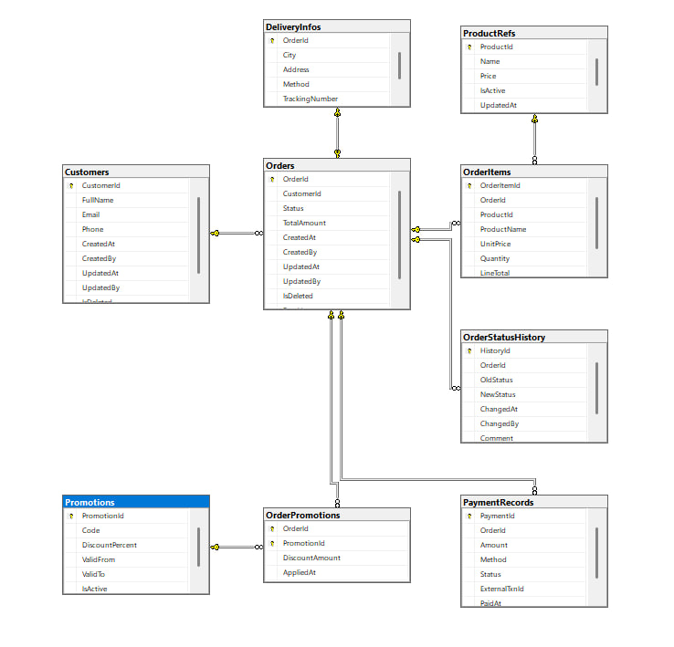
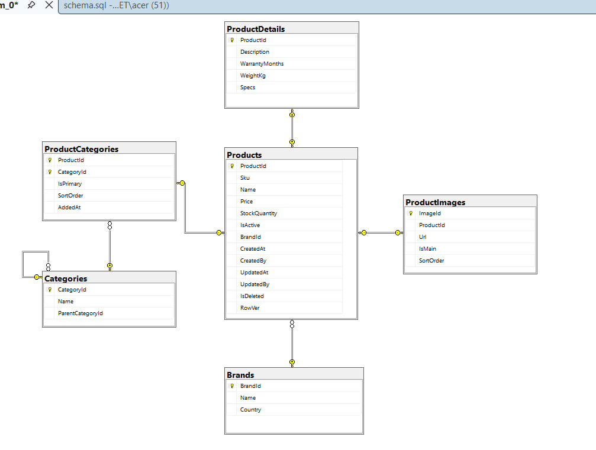

# TechStore: лабораторна 01. Проєктування трьох баз

## Предметна область
TechStore: інтернет-магазин побутової техніки та електроніки. Покупці переглядають каталог, оформлюють і оплачують замовлення, а після отримання залишають відгуки та обговорюють товари. Менеджери ведуть каталог і стежать за статусами замовлень.

## Три незалежні контексти
| № | Контекст | Сховище | Сутності |
|---|----------|---------|----------|
| 1 | Замовлення `TechStore_Orders` | SQL Server (ADO.NET + Dapper) | Customer, Order, OrderItem, DeliveryInfo, OrderStatusHistory, PaymentRecord, Promotion, OrderPromotion, ProductRef |
| 2 | Каталог `TechStore_Catalog` | SQL Server (EF Core, Code First) | Brand, Product, ProductDetail, ProductImage, Category, ProductCategory |
| 3 | Відгуки `TechStore_Reviews` | MongoDB (документна модель) | reviews, discussions, comments, ratings |

Агрегати та зв'язки: [docs/contexts.md](docs/contexts.md). Моделювання MongoDB: [docs/mongo-design.md](docs/mongo-design.md).

**Між базами немає жодного FOREIGN KEY.** Посилання між контекстами логічні, цілісність перевіряє застосунок. Дві копії, що редагуються незалежно (dual write), заборонені: у кожного поля один власник.

## Таблиця політики дублювання даних
| Поле | Де зберігається | Джерело (власник) | Політика узгодженості |
|------|-----------------|-------------------|-----------------------|
| OrderItems.ProductName, UnitPrice | БД Замовлень | Catalog: Products.Name, Price | Знімок на момент оформлення, не оновлюється |
| ProductRefs.Name, Price, IsActive | БД Замовлень | Catalog: Products | Оновлюється подією ProductUpdated (eventual consistency) |
| OrderItems.ProductId | БД Замовлень | Catalog: Products.ProductId | Логічне посилання, без FK; цілісність перевіряє застосунок |
| reviews.productId, discussions.productId | MongoDB | Catalog: Products.ProductId | Логічне посилання, без FK |
| reviews.productName, discussions.productName | MongoDB | Catalog: Products.Name | Оновлюється подією ProductUpdated |
| reviews.orderId, reviews.isVerifiedPurchase | MongoDB | Orders: Orders.OrderId (статус Delivered) | Знімок при створенні відгуку, не оновлюється |
| reviews.author.displayName, comments.author.displayName | MongoDB | Orders: Customers.FullName | Оновлюється подією CustomerUpdated |
| ratings.avg, ratings.count | MongoDB | Reviews (власник: сам контекст) | Перераховується при зміні відгуків; інші сервіси лише читають |

## Структура
```
db/
├── p1/  schema.sql · procedures.sql · seed.sql · security.sql · checks.sql   (Orders, SQL Server)
├── p2/  schema.sql · seed.sql · checks.sql                                  (Catalog, SQL Server)
├── p3/  collections.js · seed.js · checks.js                                (Reviews, MongoDB)
├── deploy.sh · deploy.ps1
docs/    ERD, contexts.md, mongo-design.md
```

## Проєкт №1: Orders
- Таблиці: Customers, ProductRefs, Promotions, Orders, DeliveryInfos, OrderItems, OrderStatusHistory, PaymentRecords, OrderPromotions.
- Зв'язки: 1:1 Orders↔DeliveryInfos (PK=FK); 1:N Customers→Orders, Orders→OrderItems/OrderStatusHistory/PaymentRecords; M:N Orders↔Promotions через OrderPromotions (DiscountAmount).
- Аудит (CreatedAt/By, UpdatedAt/By), м'яке видалення (`IsDeleted`), оптимістична конкурентність (`RowVer ROWVERSION`).
- Індекси під запити: `IX_Orders_Active` (фільтрований, замовлення клієнта), `IX_Orders_Status`, `IX_OrderItems_ProductId`, `IX_History_Order_ChangedAt` та ін.
- Процедури: `usp_CreateOrder`, `usp_ChangeOrderStatus` (транзакційна зміна статусу з перевіркою переходів і записом в історію), `usp_ConfirmOrder`, `usp_ApplyPromotion`, `usp_RegisterPayment`, `usp_GetOrderDetails`; представлення `vw_OrderSummary`.
- Статуси: Submitted → AwaitingValidation → StockConfirmed → Paid → Shipped → Delivered (Cancelled з ранніх станів).

## Проєкт №2: Catalog
Brands, Categories (самопосилання), Products, ProductDetails (1:1), ProductImages (1:N), ProductCategories (M:N з полями IsPrimary, SortOrder, AddedAt). Часткові унікальні індекси гарантують одне головне зображення та одну основну категорію.

## Проєкт №3: Reviews (MongoDB)
Колекції `reviews` (embedding), `discussions` + `comments` (referencing + hybrid `lastComments`), `ratings`. JSON Schema-валідатор, індекси, версіонування схеми (`schemaVersion`) і оптимістична конкурентність (`version`).

## Обґрунтування рішень
- **Первинні ключі:** `BIGINT IDENTITY`: кожну БД наповнює одне джерело, вставка послідовна, ключ компактний для індексів. Ідентифікатори товарів у Orders (`ProductRefs.ProductId`) не генеруються, а копіюються з Каталогу. У MongoDB використано `ObjectId`.
- **Каскади:** `ON DELETE CASCADE` лише для частин агрегату замовлення (DeliveryInfos, OrderItems, OrderStatusHistory, OrderPromotions) і для частин товару (ProductDetails, ProductImages, ProductCategories). Для Customers→Orders, PaymentRecords, Promotions, Brands і Categories каскаду немає, щоб історія не зникала; клієнти видаляються м'яко (`IsDeleted`).
- **Конкурентність:** `RowVer ROWVERSION` у Orders і Products (Каталог): ці рядки паралельно змінюють менеджери та процедури. У Mongo роль токена виконує поле `version` (`updateOne` з фільтром `{_id, version}`). Для Customers і довідників окремий токен не потрібен: вони змінюються рідко.
- **Транзакційні процедури** використовують `UPDLOCK, HOLDLOCK` на рядку замовлення, тому паралельна зміна статусу неможлива.
- **Читання:** денормалізовані `vw_OrderSummary`, `vw_ProductCard`.
- **Міграції:** схема Каталогу розрахована на перенесення в EF Core Code First (Лаб. 03), де вона стане початковою міграцією. У Mongo версія схеми зберігається в `schemaVersion`, міграція показана в `p3/checks.js`.

## Розгортання (порядок запуску)
Потрібні SQL Server, `sqlcmd`, MongoDB, `mongosh`. `sqlcmd` запускайте з прапорцями `-I` (QUOTED_IDENTIFIER ON, інакше падають вставки в таблиці з фільтрованими індексами та обчислюваними стовпцями) і `-f 65001` (UTF-8 для кирилиці); у скриптах розгортання вони вже є. У SSMS / Azure Data Studio достатньо відкрити й виконати файл.
```bash
cd db
SQL_PASS='<пароль sa>' ./deploy.sh          # Linux/macOS/WSL
.\deploy.ps1 -Pass '<пароль sa>'            # Windows
```
Вручну (`sqlcmd -S localhost -U sa -P ... -C -b -I -f 65001 -i <файл>`): `p1/schema.sql` → `p1/procedures.sql` → `p1/seed.sql` → `p1/security.sql` → `p2/schema.sql` → `p2/seed.sql` → `p3/collections.js` → `p3/seed.js`.
Усі скрипти ідемпотентні (повторний запуск безпечний). Перевірки: `p1/checks.sql`, `p2/checks.sql`, `p3/checks.js`.

## ERD




## Лаб. 02–05: мікросервіси й Aspire-платформа

Рішення `Platform.slnx` містить три бізнес-сервіси, Aspire AppHost, спільні ServiceDefaults, YARP Gateway та Aggregator:

| Сервіс | Проєкт №  | Доступ до даних | База |
|---|---|---|---|
| `Services/Orders` | 1 | ADO.NET + Dapper, Unit of Work | `TechStore_Orders` (SQL-скрипти з `db/p1`) |
| `Services/Catalog` | 2 | EF Core (Code-First), Unit of Work | `TechStore_CatalogEf` (створюється міграціями) |
| `Services/Reviews` | 3 | Clean Architecture, CQRS, MongoDB | `TechStore_Reviews` |

Шари кожного сервісу: `*.Api` → `*.Bll` → `*.Dal`, спільні моделі та винятки в `*.Domain`.

### Вимоги
- .NET 10 SDK, SQL Server (у прикладах інстанс `localhost\SQLEXPRESS`, автентифікація Windows)
- інструмент `dotnet-ef`: `dotnet tool install --global dotnet-ef`

### Розгортання баз даних
**Orders** (скрипти Лаб. 01), у такому порядку: `db/p1/schema.sql` → `db/p1/procedures.sql` → `db/p1/seed.sql`
(опційно `db/p1/security.sql`). Скрипти ідемпотентні.

**Catalog** створюється з моделей міграціями. Окремо нічого виконувати не треба: застосунок
сам викликає `MigrateAsync()` та ідемпотентний сідінг при старті (у `Production` сідінг вимкнено).
Вручну:
```powershell
dotnet ef database update --project Services/Catalog/Catalog.Dal --startup-project Services/Catalog/Catalog.Api
```
Нова міграція після зміни моделей:
```powershell
dotnet ef migrations add <Назва> --project Services/Catalog/Catalog.Dal --startup-project Services/Catalog/Catalog.Api
```
SQL-скрипт усіх міграцій: `Services/Catalog/Catalog.Dal/Migrations/catalog-migrations.sql`
(генерується командою `dotnet ef migrations script --idempotent ... -o ...`).

Сідінг: довідники (`Brands`, `Categories`) задані статично через `HasData`, товари, зображення,
деталі та зв'язки з категоріями додає `DbInitializer` лише якщо таблиця `Products` порожня,
тож повторний запуск не створює дублів.

### Запуск через Aspire
У `Platform.AppHost/AppHost.cs` оголошені SQL Server і MongoDB з постійними volume. Aspire передає сервіcам рядки підключення `OrdersDb`, `CatalogDb` і `ReviewsDb` через `WithReference`.
Задайте секрет SQL Server і запустіть платформу:
```powershell
dotnet user-secrets set "Parameters:sql-password" "Use-a-strong-password-123!" --project Platform.AppHost
dotnet run --project Platform.AppHost
```
Dashboard має показати SQL Server, MongoDB, `orders-api`, `catalog-api`, `reviews-api`, `aggregator` і `gateway` у статусі Running. Клієнтський Gateway: `http://localhost:5000`; API маршрути: `/api/orders`, `/api/products`, `/api/reviews`, `/api/aggregator/orders/{id}/full`.
JWT validation у Gateway вмикається через конфігурацію `Authentication:Jwt:Authority`, `Audience` і `RequireAuthentication`; за замовчуванням auth вимкнений для локальної демонстрації.

Один сервіс без Aspire:
```powershell
dotnet run --project Services/Orders/Orders.Api
dotnet run --project Services/Catalog/Catalog.Api
```

### Приклади запитів
Замініть `PORT` на порт сервісу з Dashboard. У PowerShell використовуйте `curl.exe`.

**Catalog**
```bash
# пагінація, фільтрація, сортування (виконуються в SQL)
curl "https://localhost:PORT/api/products?page=2&pageSize=5&search=Sony&minPrice=5000&sortBy=price&sortDir=desc"
# картка товару (Eager Loading)
curl https://localhost:PORT/api/products/1
# товари категорії (Explicit Loading)
curl https://localhost:PORT/api/categories/2/products
# нові товари в категорії за поле AddedAt (M:N)
curl "https://localhost:PORT/api/products/recent?category=Смартфони&days=30"
# створення (201 + Location); повтор з тим самим SKU дає 409, порожнє name дає 400
curl -X POST https://localhost:PORT/api/products -H "Content-Type: application/json" \
  -d '{"name":"Test phone","sku":"TST-1","price":999,"brandId":1,"initialStock":5}'
# нестача залишку дає 409
curl -X POST https://localhost:PORT/api/products/1/stock/remove -H "Content-Type: application/json" -d '{"quantity":999}'
```
Відповідь списку: `items`, `totalCount`, `page`, `pageSize`, `totalPages`, `hasNext`, `hasPrevious`
у тілі, а `totalCount` і `totalPages` ще й у заголовках `X-Total-Count`, `X-Total-Pages`.
`pageSize` обмежено 1–100, `sortBy`: `name` | `price` | `stock`.

**Orders**
```bash
curl https://localhost:PORT/api/customers
curl https://localhost:PORT/api/orders/9999                 # 404, ProblemDetails
curl -X POST https://localhost:PORT/api/orders/2/confirm    # 204, повтор дає 409
curl -X POST https://localhost:PORT/api/orders/2/payments -H "Content-Type: application/json" \
  -d '{"amount":27999,"method":"Card","externalTxnId":"TXN-0002"}'
```

### Помилки та логування
Усі помилки повертаються у форматі `ProblemDetails` (400 валідація, 404 не знайдено, 409 конфлікт).
Логи структуровані (Serilog, консоль + `logs/catalog-*.log`), у кожному записі є `CorrelationId`,
`RequestPath`, `UserId`. SQL-команди EF Core логуються на рівні Information
(видно, що Eager Loading виконує один запит, а Explicit Loading два).

### Політика дублювання даних між контекстами
| Дані | Власник | Копія | Де | Призначення |
|---|---|---|---|---|
| `Name`, `Price`, `IsActive` товару | Catalog (`Products`) | `ProductRefs` | Orders | довідкова копія, щоб створити замовлення без запиту до Catalog |
| `ProductName`, `UnitPrice` | Orders (`OrderItems`) | знімок із `ProductRefs` на момент замовлення | Orders | історія замовлення не змінюється при зміні ціни чи назви |
| `productName` | Catalog (`Products`) | поле в `reviews`, `discussions` | Reviews (MongoDB) | показ відгуку без JOIN; оновлюється `updateMany` |
| ім'я клієнта (`displayName`) | Orders (`Customers`) | `author`, `createdBy` у `reviews`, `discussions`, `comments` | Reviews (MongoDB) | відображення автора |
| `orderId` | Orders (`Orders`) | `reviews.orderId` + `isVerifiedPurchase` | Reviews (MongoDB) | посилання на покупку, зв'язок без FK |
| оцінки (`count`, `sum`, `avg`, `distribution`) | Reviews (`reviews`) | `ratings` | Reviews (MongoDB) | швидке читання рейтингу |
| `commentCount`, `lastComments` | Reviews (`comments`) | вбудовано в `discussions` | Reviews (MongoDB) | швидка картка дискусії |

Залишок товару (`StockQuantity`) зберігається лише в Catalog і ніде не дублюється.

## Lab 05: .NET Aspire platform

The solution includes `Platform.AppHost`, shared `Platform.ServiceDefaults`, `Platform.ApiGateway`, and `Platform.Aggregator`. Aspire starts SQL Server and MongoDB with persistent data volumes and wires the existing Orders, Catalog, and Reviews APIs to their databases using connection string references.

### Run locally

1. Start Docker Desktop.
2. Set the SQL Server `sa` password once from the repository root:

   ```powershell
   dotnet user-secrets set "Parameters:sql-password" "Use-a-strong-password-123!" --project Platform.AppHost
   ```

3. Start the platform:

   ```powershell
   dotnet run --project Platform.AppHost
   ```

Aspire opens its Dashboard. The public Gateway listens on `http://localhost:5000`. Example routes are `/api/orders`, `/api/products`, `/api/reviews`, and `/api/aggregator/orders/{id}/full`. The Gateway assigns/forwards `X-Correlation-Id`; the Aggregator fans out catalog and review lookups in parallel and includes unavailable-service warnings in its response.

The Catalog schema is created by EF migrations, Reviews creates its indexes and seed data at startup, and Orders bootstraps its schema, procedures, and seed data from the idempotent Lab 02 scripts in `db/p1` when the API starts.

### Lab 05: requests through the Gateway

Run these examples after the AppHost resources are healthy. Use `curl.exe` in PowerShell so `curl` is not interpreted as the PowerShell alias.

```powershell
# Product list through YARP Gateway; expected: 200 OK with a paged JSON response.
curl.exe -i "http://localhost:5000/api/products?page=1&pageSize=10"

# Full order card through Gateway -> Aggregator -> Orders, Catalog, Reviews.
# Expected: 200 OK with order/products/reviews/warnings; 404 if order 1 does not exist.
curl.exe -i "http://localhost:5000/api/aggregator/orders/1/full"
```

The second response contains partial data and a `warnings` entry if Catalog or Reviews is unavailable. Both requests include the Gateway-generated `X-Correlation-Id` response header.

## Lab 06: gRPC and two-level caching

Aspire also starts a persistent Redis resource named `redis`. Catalog, Orders, Reviews, and Aggregator receive its connection string through service discovery. Catalog product cards use a 45-second in-memory L1 cache and a 10-minute Redis L2 cache; successful product writes invalidate the product key. If Redis is unavailable, Catalog and Aggregator continue with database/live calls and log the cache failure.

The internal read contracts are in `Services/Catalog/Catalog.Api/Protos`, `Services/Orders/Orders.Api/Protos`, and `Services/Reviews/Reviews.WebApi/Protos`. Their APIs serve gRPC over HTTP/2, and Aggregator uses generated typed gRPC clients for Orders, Catalog, and Reviews. The public routes remain HTTP through Gateway:

```powershell
# Public HTTP route; internally Aggregator calls the three services over gRPC.
curl.exe -i "http://localhost:5000/api/aggregator/orders/1/full"

# Change a product, then read it again to observe cache invalidation.
curl.exe -i -X PUT "http://localhost:5000/api/products/1/price" -H "Content-Type: application/json" -d '{"price":12345}'
curl.exe -i "http://localhost:5000/api/products/1"
```

Look for `cache.hits`, `cache.misses`, and `cache.invalidations` under the `Catalog.Cache` meter and gRPC spans in the Aspire Dashboard.
