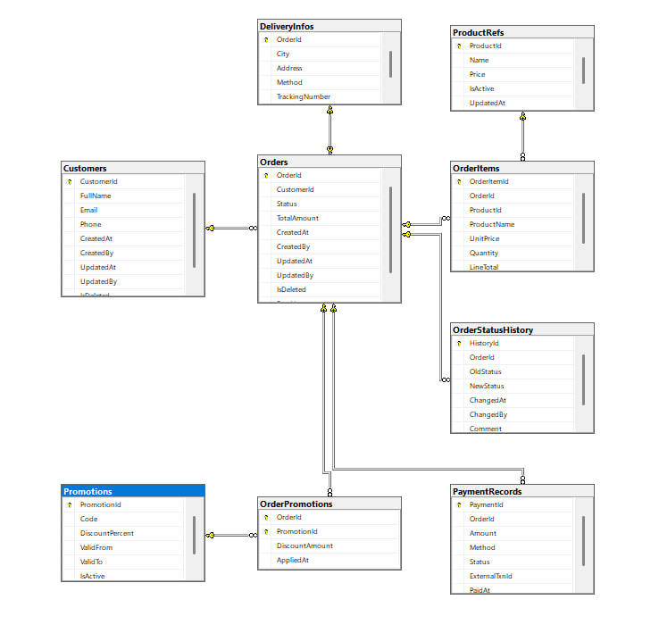
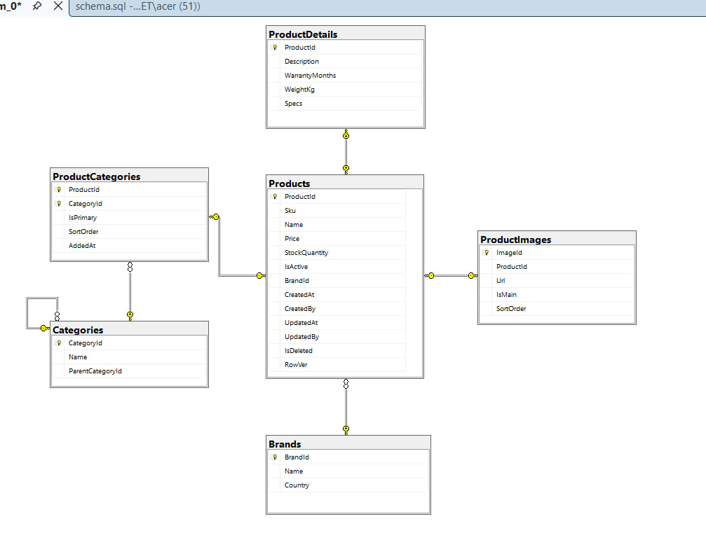

# TechStore: лабораторна 01. Проєктування трьох баз

## Предметна область
TechStore: інтернет-магазин побутової техніки та електроніки. Покупці переглядають каталог, оформлюють і оплачують замовлення, а після отримання залишають відгуки та обговорюють товари. Менеджери ведуть каталог і стежать за статусами замовлень.

## Три незалежні контексти
| № | Контекст | Сховище | Сутності |
|---|----------|---------|----------|
| 1 | Замовлення `TechStore_Orders` | SQL Server (ADO.NET + Dapper) | Customer, Order, OrderItem, DeliveryInfo, OrderStatusHistory, PaymentRecord, Promotion, OrderPromotion, ProductRef |
| 2 | Каталог `TechStore_Catalog` | SQL Server (EF Core, Code First) | Brand, Product, ProductDetail, ProductImage, Category, ProductCategory |
| 3 | Відгуки `TechStore_Reviews` | MongoDB (документна модель) | reviews, discussions, comments, ratings |

Агрегати та зв'язки: [docs/contexts.md](docs/contexts.md). Моделювання MongoDB: [docs/mongo-design.md](docs/mongo-design.md).

**Між базами немає жодного FOREIGN KEY.** Посилання між контекстами логічні, цілісність перевіряє застосунок. Дві копії, що редагуються незалежно (dual write), заборонені: у кожного поля один власник.

## Таблиця політики дублювання даних
| Поле | Де зберігається | Джерело (власник) | Політика узгодженості |
|------|-----------------|-------------------|-----------------------|
| OrderItems.ProductName, UnitPrice | БД Замовлень | Catalog: Products.Name, Price | Знімок на момент оформлення, не оновлюється |
| ProductRefs.Name, Price, IsActive | БД Замовлень | Catalog: Products | Оновлюється подією ProductUpdated (eventual consistency) |
| OrderItems.ProductId | БД Замовлень | Catalog: Products.ProductId | Логічне посилання, без FK; цілісність перевіряє застосунок |
| reviews.productId, discussions.productId | MongoDB | Catalog: Products.ProductId | Логічне посилання, без FK |
| reviews.productName, discussions.productName | MongoDB | Catalog: Products.Name | Оновлюється подією ProductUpdated |
| reviews.orderId, reviews.isVerifiedPurchase | MongoDB | Orders: Orders.OrderId (статус Delivered) | Знімок при створенні відгуку, не оновлюється |
| reviews.author.displayName, comments.author.displayName | MongoDB | Orders: Customers.FullName | Оновлюється подією CustomerUpdated |
| ratings.avg, ratings.count | MongoDB | Reviews (власник: сам контекст) | Перераховується при зміні відгуків; інші сервіси лише читають |

## Структура
```
db/
├── p1/  schema.sql · procedures.sql · seed.sql · security.sql · checks.sql   (Orders, SQL Server)
├── p2/  schema.sql · seed.sql · checks.sql                                  (Catalog, SQL Server)
├── p3/  collections.js · seed.js · checks.js                                (Reviews, MongoDB)
├── deploy.sh · deploy.ps1
docs/    ERD, contexts.md, mongo-design.md
```

## Проєкт №1: Orders
- Таблиці: Customers, ProductRefs, Promotions, Orders, DeliveryInfos, OrderItems, OrderStatusHistory, PaymentRecords, OrderPromotions.
- Зв'язки: 1:1 Orders↔DeliveryInfos (PK=FK); 1:N Customers→Orders, Orders→OrderItems/OrderStatusHistory/PaymentRecords; M:N Orders↔Promotions через OrderPromotions (DiscountAmount).
- Аудит (CreatedAt/By, UpdatedAt/By), м'яке видалення (`IsDeleted`), оптимістична конкурентність (`RowVer ROWVERSION`).
- Індекси під запити: `IX_Orders_Active` (фільтрований, замовлення клієнта), `IX_Orders_Status`, `IX_OrderItems_ProductId`, `IX_History_Order_ChangedAt` та ін.
- Процедури: `usp_CreateOrder`, `usp_ChangeOrderStatus` (транзакційна зміна статусу з перевіркою переходів і записом в історію), `usp_ConfirmOrder`, `usp_ApplyPromotion`, `usp_RegisterPayment`, `usp_GetOrderDetails`; представлення `vw_OrderSummary`.
- Статуси: Submitted → AwaitingValidation → StockConfirmed → Paid → Shipped → Delivered (Cancelled з ранніх станів).

## Проєкт №2: Catalog
Brands, Categories (самопосилання), Products, ProductDetails (1:1), ProductImages (1:N), ProductCategories (M:N з полями IsPrimary, SortOrder, AddedAt). Часткові унікальні індекси гарантують одне головне зображення та одну основну категорію.

## Проєкт №3: Reviews (MongoDB)
Колекції `reviews` (embedding), `discussions` + `comments` (referencing + hybrid `lastComments`), `ratings`. JSON Schema-валідатор, індекси, версіонування схеми (`schemaVersion`) і оптимістична конкурентність (`version`).

## Обґрунтування рішень
- **Первинні ключі:** `BIGINT IDENTITY`: кожну БД наповнює одне джерело, вставка послідовна, ключ компактний для індексів. Ідентифікатори товарів у Orders (`ProductRefs.ProductId`) не генеруються, а копіюються з Каталогу. У MongoDB використано `ObjectId`.
- **Каскади:** `ON DELETE CASCADE` лише для частин агрегату замовлення (DeliveryInfos, OrderItems, OrderStatusHistory, OrderPromotions) і для частин товару (ProductDetails, ProductImages, ProductCategories). Для Customers→Orders, PaymentRecords, Promotions, Brands і Categories каскаду немає, щоб історія не зникала; клієнти видаляються м'яко (`IsDeleted`).
- **Конкурентність:** `RowVer ROWVERSION` у Orders і Products (Каталог): ці рядки паралельно змінюють менеджери та процедури. У Mongo роль токена виконує поле `version` (`updateOne` з фільтром `{_id, version}`). Для Customers і довідників окремий токен не потрібен: вони змінюються рідко.
- **Транзакційні процедури** використовують `UPDLOCK, HOLDLOCK` на рядку замовлення, тому паралельна зміна статусу неможлива.
- **Читання:** денормалізовані `vw_OrderSummary`, `vw_ProductCard`.
- **Міграції:** схема Каталогу розрахована на перенесення в EF Core Code First (Лаб. 03), де вона стане початковою міграцією. У Mongo версія схеми зберігається в `schemaVersion`, міграція показана в `p3/checks.js`.

## Розгортання (порядок запуску)
Потрібні SQL Server, `sqlcmd`, MongoDB, `mongosh`. `sqlcmd` запускайте з прапорцями `-I` (QUOTED_IDENTIFIER ON, інакше падають вставки в таблиці з фільтрованими індексами та обчислюваними стовпцями) і `-f 65001` (UTF-8 для кирилиці); у скриптах розгортання вони вже є. У SSMS / Azure Data Studio достатньо відкрити й виконати файл.
```bash
cd db
SQL_PASS='<пароль sa>' ./deploy.sh          # Linux/macOS/WSL
.\deploy.ps1 -Pass '<пароль sa>'            # Windows
```
Вручну (`sqlcmd -S localhost -U sa -P ... -C -b -I -f 65001 -i <файл>`): `p1/schema.sql` → `p1/procedures.sql` → `p1/seed.sql` → `p1/security.sql` → `p2/schema.sql` → `p2/seed.sql` → `p3/collections.js` → `p3/seed.js`.
Усі скрипти ідемпотентні (повторний запуск безпечний). Перевірки: `p1/checks.sql`, `p2/checks.sql`, `p3/checks.js`.

## ERD




# TechStore Platform — Orders service

## Вимоги
.NET SDK 9+, SQL Server (локальний), скрипти БД виконані в порядку:
schema.sql → procedures.sql → seed.sql → (security.sql)

## Запуск
dotnet dev-certs https --trust
dotnet run --project Platform.AppHost
Aspire Dashboard: адреса в консолі. Swagger: <URL orders-api>/swagger

## Схема рішення
Orders.Api → Orders.Bll → Orders.Dal; Orders.Domain спільний.
Транзакційна операція: POST /api/orders/{id}/payments
(PaymentRecords + Orders + OrderStatusHistory в одній транзакції).
Ізоляція: ReadCommitted; процедури додатково беруть UPDLOCK/HOLDLOCK.

## Приклади запитів
curl -X POST http://localhost:PORT/api/customers -H "Content-Type: application/json" \
  -d '{"fullName":"Тест","email":"t@example.com","phone":"+380931234567"}'

curl -X POST http://localhost:PORT/api/orders -H "Content-Type: application/json" \
  -d '{"customerId":1,"city":"Чернівці","address":"вул. Головна, 1","deliveryMethod":"Courier","items":[{"productId":1,"quantity":1}]}'

curl -X POST http://localhost:PORT/api/orders/2/confirm
curl -X POST http://localhost:PORT/api/orders/2/payments -H "Content-Type: application/json" \
  -d '{"amount":27999,"method":"Card","externalTxnId":"TXN-0002"}'
curl http://localhost:PORT/api/orders/9999     # 404 ProblemDetails
